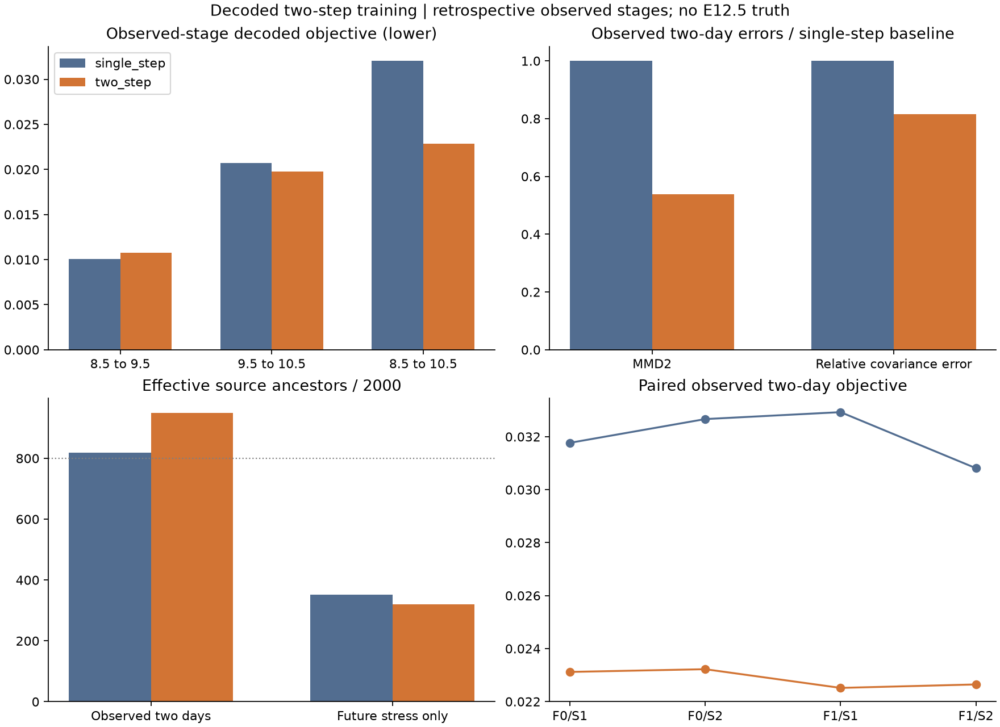

# T1 P3 / E12.5 独立研究与预测 · 2026-11-26

已发布本轮独立审查、全部后续实验的代码和结果，以及E12.5本地预测。**两步表达训练改善已观察区间的拟合，但没有解决未来的来源权重集中；不声称E12.5准确率提高。**

## 下载

- [E12.5预测包](https://github.com/2400010793/statistic/releases/download/t1-e125-research-20261126/T1-E12.5-predictions-20261126.zip)：6个2000×32285预测矩阵（4个新候选、CopyLast与damped_group），T1:test基因面板、来源记录和校验清单。
- [完整研究复现包](https://github.com/2400010793/statistic/releases/download/t1-e125-research-20261126/T1-research-replay-20261126.zip)：本轮全部脚本、报告、图表、冻结参数、模型权重、源索引、加权源池及所需历史基线。保留项目目录层级，可独立解压复跑。
- [Release及附件SHA-256](https://github.com/2400010793/statistic/releases/tag/t1-e125-research-20261126)。原始E8.5/E9.5/E10.5数据和Python环境不在包内。

## 本轮实际得到什么

8个配对模型比较单步训练与新增两步闭环训练；随后以三个允许阶段的全部细胞重训4个模型。网络容量同为29250参数，配对初始化、数据划分、源细胞、外生小批量和修改预算相同。两步组增加计算，不声称算力匹配。

| 已观察E8.5→E10.5两日过程，留出细胞指标 | 单步训练 | 两步训练 |
|---|---:|---:|
| 实际输出主目标 ↓ | 0.032043 | 0.022876 |
| MMD² ↓ | 0.012458 | 0.006702 |
| 协方差相对误差 ↓ | 0.331216 | 0.270346 |
| 全基因总体RMSE ↓ | 0.039879 | 0.037667 |
| 来源ESS / 2000 ↑ | 819.1 | 949.7 |

代价：E8.5→E9.5单日主目标增加6.7%，E9.5→E10.5簇内RMSE增加0.25%。指标来自log1p(CP10K)实际解码输出，分布指标采用冻结早期PCA32和三个RBF带宽；完整定义见[运行前方案](../../analysis/independent_review_20261126/two_step_rollout_v2/protocol.txt)和[结果报告](../../analysis/independent_review_20261126/two_step_rollout_v2/report.txt)。

**未来稳定性门槛失败。** 分半配置从E10.5推进两天，来源ESS由351降到320。全量模型的双种子分布混合中，单步/两步延续版的唯一来源ESS为367.4/328.2；第二天减速后为464.2/398.1。此处ESS是集中度指标，不是未来准确率。

事后诊断中，连续两天的log质量增量相关约0.99，反复强化相同来源。两步延续版把93.4%的权重放到起点只占15.7%的同一个来源簇；其314个起始细胞中302个标为Blood。这是祖先来源簇权重，不是经过独立验证的未来细胞类型比例。下一步应优先单独控制丰度的累计变化，而非仅扩大网络。

E10.5参与拟合，历史上也已多次用于开发。同阶段换细胞、换种子或交换两半都不是多个独立发育时点。E12.5无本地真值，本轮没有新的官方分数，发布文件也不等于官网提交。

## 研究记录入口

- [独立初始判断](../../analysis/independent_review_20261126/initial_judgment.md)、[数据检查](../../analysis/independent_review_20261126/data_inspection.json)、[R40/模块复核](../../analysis/independent_review_20261126/review_report.txt)。
- [基因身份对照](../../analysis/independent_review_20261126/gene_identity_control/report.txt)、[比例/均值/协方差分解](../../analysis/independent_review_20261126/moment_factorial_diagnostic/report.txt)。
- [比例预测负结果](../../analysis/independent_review_20261126/composition_forecast_trial/report.txt)、[联合动力学负结果](../../analysis/independent_review_20261126/joint_dynamics_trial/report.txt)。
- [速度与方向诊断](../../analysis/independent_review_20261126/speed_direction_diagnostic/findings_and_model_decision.txt)、[阶段条件与实际解码训练](../../analysis/independent_review_20261126/stage_conditioned_decoder_v1/findings_and_decision.txt)。
- [两天压力检查](../../analysis/independent_review_20261126/e125_readiness/next_steps.txt)、[本轮两步结论](../../analysis/independent_review_20261126/two_step_rollout_v2/findings_and_decision.txt)、[模型卡](../../analysis/independent_review_20261126/two_step_rollout_v2/model_card.json)。



## 复跑

只下载预测时，解压小包并执行 `python verify_release.py .`。完整复跑使用大包，以其中根目录为工作目录；它包含必要的冻结前置产物，不需要重新执行全部历史实验。

1. 从官方渠道获取本人已获授权的三个阶段数据，放到 `data/raw/T1/E8.5_RNA.h5ad`、`data/raw/T1/E9.5_RNA.h5ad`、`data/p3/T1/E10.5_RNA.h5ad`。原始文件校验值见[raw_data.sha256](raw_data.sha256)。
2. 参考[实际环境版本](environment.json)安装依赖。原实验使用Python 3.14.6、macOS arm64、CPU每模型2线程；跨平台浮点结果可能有微小差异。历史目录里的`deps`未打包，Torch安装到虚拟环境即可。
3. 在工作副本里运行下列命令。完整训练会重新写本次实验的本地结果；发布的冻结结果仍保存在下载包中。

```bash
python3 -m venv .venv
.venv/bin/python -m pip install -r requirements-research.txt
.venv/bin/python experiments/t1-e125-20261126/verify_release.py . --data
.venv/bin/python analysis/independent_review_20261126/two_step_rollout_v2/run_all.py
```

只从已保存的全量检查点重新生成E12.5矩阵，可在放好数据后执行：

```bash
.venv/bin/python analysis/independent_review_20261126/two_step_rollout_v2/export_e125.py
```

代码在仓库保持原项目路径；大体积数组和预测在Release。将大包内容合并到仓库时应先用工作副本。发布文本统一了换行及JSON排版，并将原项目绝对路径替换为相对路径；数值数组、预测和权重字节不变。[publication_manifest.json](publication_manifest.json)同时记录原始与发布副本哈希。历史输入哈希描述原运行状态，下载完整性以包内SHA256SUMS为准。

## 数据来源与历史结果

官方胚胎数据由UCSD Neil Chi团队生成，致谢Qingquan Zhang、Neil Chi和Virtual Embryo Challenge。使用者自行获取有权限使用的原始数据。本轮只做本地研究；此前R40的51.0397是P2 E10.5历史分数，参见[原交接记录](https://github.com/2400010793/statistic/blob/main/experiments/t1-r40/README.md)，不能归给本轮E12.5候选。
